<picture>
  <source media="(prefers-color-scheme: dark)" srcset="assets/banner-dark.svg">
  <source media="(prefers-color-scheme: light)" srcset="assets/banner-light.svg">
  
</picture>

  

## About me

I'm a third-year **Information Technology student at the University of Economics Ho Chi Minh City (UEH)**.
I have a foundation in programming, web and mobile development, and databases, and I'm now moving toward **AI Engineering**.

- 🌱 **Learning:** AI fundamentals — my first AI projects will land here soon
- 🧑‍💻 **Experience:** team leader and team member on academic software projects

## AI learning path

<picture>
  <source media="(prefers-color-scheme: dark)" srcset="assets/journey-dark.svg">
  <source media="(prefers-color-scheme: light)" srcset="assets/journey-light.svg">
  
</picture>

## Projects & tools

  <a href="https://github.com/mdattrnh/MELODYVERSE"><picture><source media="(prefers-color-scheme: dark)" srcset="assets/project-melodyverse-dark.svg"><source media="(prefers-color-scheme: light)" srcset="assets/project-melodyverse-light.svg"></picture></a>
  <a href="https://github.com/mdattrnh/Do-An-Phat-trien-ung-dung-Web-Nhom-02"><picture><source media="(prefers-color-scheme: dark)" srcset="assets/project-softedge-dark.svg"><source media="(prefers-color-scheme: light)" srcset="assets/project-softedge-light.svg"></picture></a>

## Tech stack

**Languages**

**Web & Mobile**

**Databases & Data**

**Tools**

 
<picture>
  <source media="(prefers-color-scheme: dark)" srcset="assets/divider-dark.svg">
  <source media="(prefers-color-scheme: light)" srcset="assets/divider-light.svg">
  
</picture>

Open to connecting about software, AI and learning together.

